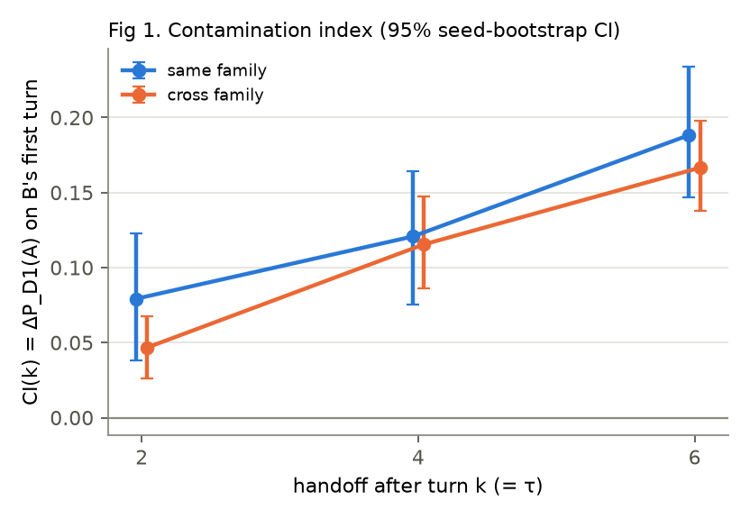
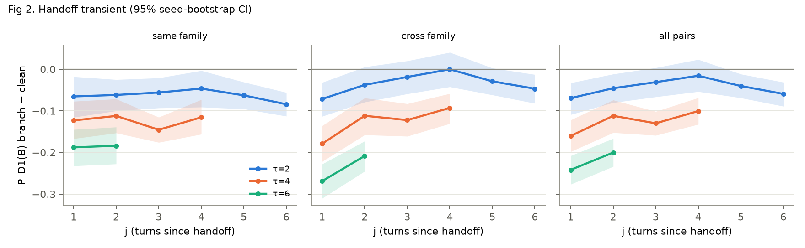

# 早期实验结果：换模型后指纹会不会被带偏

2026-10-14 · 本地两张 B300，无 API 费用 · 代码见仓库根目录 README

## 结论（一句话）

污染真实存在，以真实历史为条件的似然方法有效，**按判定表应进入一个月试点**。
但 D2 在本设置下已饱和（≈100%），试点必须把难度加上去，否则测不出方法之间的差别。

## 跑了什么

| | 反应式模拟器 `runs/full` | 回放用户轮 `runs/full_replay`（主结果） |
|---|---|---|
| 用户轮 | Llama-3.1-8B 读带标签的对话记录后写下一句 | 每个种子先由 Llama 只看目标和自己之前的发言写好 8 轮脚本，所有模型、所有分支回答同一套用户轮 |
| 捷径检查 A4 | **0.362 [0.323, 0.404]，未通过**（门槛 ≤ 0.30） | 0.250（按构造等于随机），通过 |
| 生成 | 13,600 个助手轮（与计划一致），2 h 20 min | 13,600 个助手轮，2 h 10 min |
| D2 打分 | 每个候选 13,600 轮，2×B300 约 2 h | 同左 |

反应式模拟器未通过 A4：用户轮会跟着各模型的话题漂移走，也会回答 Gemma 爱问的澄清问题（"As for…"、"I've…"）。
按计划"先修模拟器"，采用计划里给的方案之一（回放用户轮）重跑。下面的数字都来自回放版；两版的 A1/A3 结论方向一致，反应式版数值见 `runs/full/analysis/report.md`。

## 前提

- A4 只看用户轮：0.250，通过。
- D1 干净上下文逐轮准确率：**0.794 [0.759, 0.826]**（随机 0.25），第 1 轮 0.59，之后 0.76–0.88。
  错误几乎全在同族内（Gemma 12B↔27B、Qwen 8B↔32B），跨族混淆 < 3%。
- D2 干净上下文逐轮准确率：1.000（argmax 平均 token 对数概率）。

## A1 污染曲线（图 1）

B 接手后第一轮被 D1 判为 A 的概率，减去 B 在同种子、同轮次干净对话中被判为 A 的概率。

| | 合并 | k=2 | k=4 | k=6 |
|---|---|---|---|---|
| 同族 | **0.129** [0.097, 0.163] | 0.079 [0.038, 0.123] | 0.121 [0.075, 0.164] | 0.188 [0.147, 0.234] |
| 跨族 | **0.110** [0.090, 0.131] | 0.047 [0.026, 0.068] | 0.115 [0.086, 0.147] | 0.167 [0.138, 0.198] |

- 两组置信区间都不含 0，且随 k（A 留下的历史越长）单调上升。
- 剔除截断轮后不变（同族 0.129，跨族 0.112）。
- **明显的方向不对称**：Qwen 当 A 时把任何 B 都往 Qwen 拉（+0.12 到 +0.25）；Gemma 当 A 时对 Qwen 几乎没有影响（−0.001 到 +0.024），只影响另一个 Gemma（+0.13 到 +0.15）。
  猜测是 Qwen 的强格式（加粗、标题、emoji）更容易被上下文模仿，试点可用格式特征消融验证。

## A2 切换瞬态（图 2）

接手后第 j 轮，D1 给出的 P(B) 减去 B 干净对话同一绝对轮次的 P(B)。

- τ=2：j=1 为 −0.070，随后在 −0.02 到 −0.06 之间波动，多数轮次 CI 不含 0。
- τ=4：−0.160 → −0.101（j=4）。
- τ=6：−0.242 → −0.200（j=2）。

结论：**先大后小，但没有回到 0**。在观测到的 2–6 轮内只是部分恢复，历史越长，偏移越大、持续越久。

## A3 定位与检测（表 1）

随机水平：τ 精确命中 1/7 = 0.143，±1 轮 3/7 = 0.429；判定线（2 倍随机）0.286。

| 证据 / 关系 | τ 精确 | τ ±1 | (A,B) 都对 | τ 与 A、B 全对 | 检测 AUROC |
|---|---|---|---|---|---|
| D1 / 同族 | 0.375 [0.325, 0.427] | 0.658 | 0.788 | 0.365 | 0.716 [0.671, 0.762] |
| D1 / 跨族 | 0.803 [0.770, 0.837] | 0.902 | 0.627 | 0.566 | 0.943 [0.925, 0.959] |
| D2 / 同族 | 1.000 | 1.000 | 1.000 | 1.000 | 1.000 |
| D2 / 跨族 | 1.000 | 1.000 | 1.000 | 1.000 | 1.000 |

- D2 − D1 精确命中（种子内配对）：同族 +0.625 [0.573, 0.675]，跨族 +0.197 [0.163, 0.230]。
- D2 的总似然版本和校准版本同样是 1.000。
- 反应式版：D1 同族 0.293、跨族 0.743；D2 为 0.997 和 1.000。
- 原因很直接：每个模型给自己 T=0.7 采样的文本的平均对数概率，比其他候选高 0.1–0.6 nat/token，乘上每轮约 1,000 个 token，差距压倒性。

## 按判定表

| 观察 | 本次 |
|---|---|
| 跨族 CI 明显大于 0，且 D2 定位明显好于 D1 | **是**：0.110 [0.090, 0.131]；D2−D1 跨族 +0.197 [0.163, 0.230] → 进入一个月试点 |
| CI 接近 0，且 D1 定位已很准 | 否 |
| CI > 0，D1、D2 定位都差 | 否 |
| 同族与跨族结果接近 | **污染指数接近**（0.129 和 0.110，CI 重叠），**定位差别很大**（D1：0.375 和 0.803）→ 同族、跨族分组不能省 |

## 对试点的建议

1. **D2 已到天花板，要加难度。** 本设置是最有利于 D2 的白盒条件：候选权重与生成权重完全一致、采样温度已知、每轮约 1,000 个 token。试点应加入：
   - 未知或不同的采样参数（温度、top-p）；
   - 截短到少量 token 的轮次；
   - 改写或编辑过的轮次；
   - 候选池外的模型（开放集）；
   - 主方案里"减去自身采样均值"的归一化。
2. **用户轮一律回放。** 反应式模拟器确实泄露作者信息（A4 = 0.36）。回放后 A1 和 D1 的结论不变，D1 定位反而更好，说明泄露主要是噪声，而不是造出了效应。
3. **污染的方向不对称值得单列研究**：哪种风格容易"传染"，是否主要来自格式。
4. 现成的探索性结果（未列为结论）：D2 版的 A1/A2（`A1_D2`、`A2_D2`）同时混入了生成端的漂移和打分模型对不同历史的上下文适应，不能直接当污染量来读。拆开看，跨族接手后 B 的自我似然下降约 0.06 nat/token，A 对 B 那一轮的似然下降约 0.155 nat/token；要可解释，需要上下文匹配的对照。

## 与计划不同的地方（均在看结果前决定）

- **助手轮上限 2048 token，计划为 512。** 冒烟测试中 512 时 Qwen3-8B 100%、Qwen3-32B 94% 的轮次被截断。截断本身会成为作者线索，计划里"剔除截断轮"的补救会丢掉几乎全部 Qwen 数据。
  2048 下截断率：Qwen 5–6%，Gemma 低于 1%（回放版）。所有结果另有剔除截断轮的版本，结论不变。
- **用户模拟器读带 USER/AI 标签的对话记录**，没有用角色互换。冒烟测试中，角色互换让 Llama-8B 在助手问问题时滑进助手角色。
- **回放用户轮的版本是主结果**，原因是反应式版未通过 A4（计划规定的处理方式）。
- **D1 的 C 由训练种子的分组交叉验证选出**，选中网格上限 10，交叉验证准确率 0.784。更大的 C 也许还能略好，试点可以扩大网格。
- **补充报告了 D2sum、D2cal 和 D2 版 A1/A2**，均为探索性结果，不影响判定。
- 未发现跨对话的固定开场白或结尾套话，没有做去除。审计结果见 `boilerplate_audit.json`。

## 文件

- 主结果：`runs/full_replay/analysis/`，包括 `report.md`、`metrics.json`、两张图、`segments.csv`、`a1_pairs.csv`、`a2_turns.csv`。剔除截断轮的版本在 `analysis_excl_trunc/`。
- 反应式对照：`runs/full/analysis/`。
- 原始数据：`runs/*/gen/*.jsonl`（每个助手轮一行，格式同计划），`runs/*/d2/*.jsonl`，`runs/full_replay/user_scripts.jsonl`。
